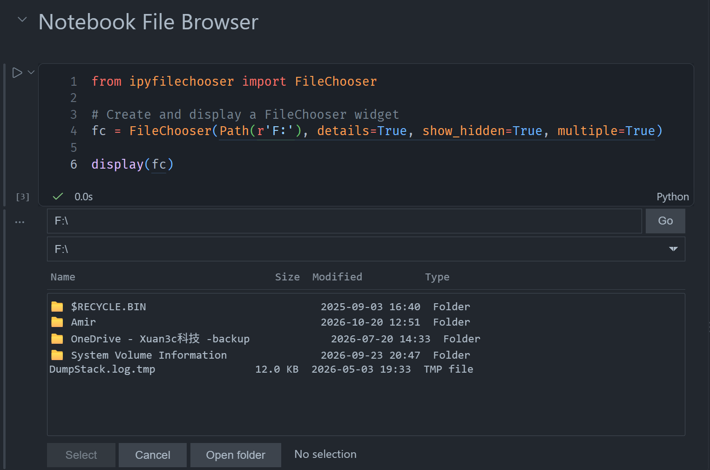

## FileChooser (Notebook File Browser)

[ipyfilechooser2](https://github.com/fathi0amir/ipyfilechooser2) brings a convenient file-selection experience directly into Jupyter notebooks. Built as an ipywidgets component, it lets you browse folders, filter files, choose a file or directory, and access the selection through simple Python properties. You can also customize the starting location, show hidden files, and restrict browsing to a sandbox directory.

Designed to feel at home in modern notebook environments, the widget supports automatic, light, and dark themes, and expands to fit the notebook layout. Helpful details—like highlighting filename matches and showing whether a selected file already exists—make choosing an output path more intuitive. This project builds on the original ipyfilechooser by Thomas Bouve, with updates focused on a smoother, more flexible Jupyter experience.