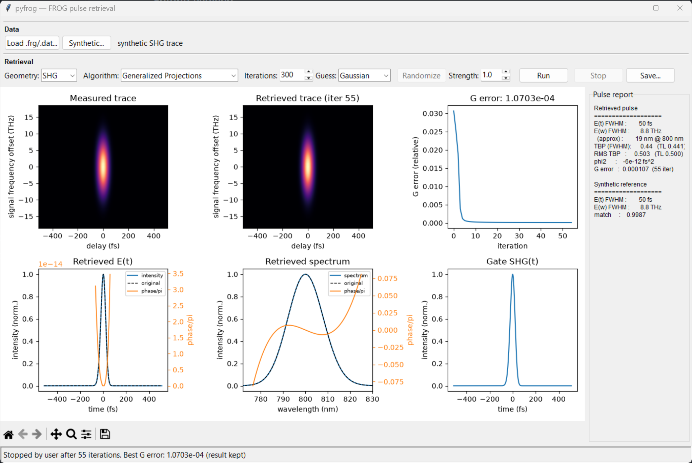

[pyfrog](https://github.com/fathi0amir/pyfrog) is an open-source Python toolkit
for Frequency-Resolved Optical Gating (FROG), a technique used to reconstruct
the intensity and phase of ultrashort laser pulses from measured traces. It
brings several established retrieval approaches into one package, including
Generalized Projections, Vanilla FROG, PCGP, and XFROG, with support for common
measurement geometries such as SHG, PG, and THG.

The project combines a scientific Python library with a Tkinter desktop
interface. Users can load existing FROG data or generate synthetic pulses and
traces, run a reconstruction, and inspect results such as the recovered field,
spectrum, pulse widths, and retrieval error. It also reads and writes common
Trebino `.frg` and `.dat` formats, making it useful for both exploring the
method and working with existing data.

Under the hood, pyfrog carefully follows conventions used by established FROG
implementations, including centered FFTs and their error metrics. Its algorithms
are ported from reference implementations, and the repository includes example
traces and tests that compare retrieval quality against reference results.