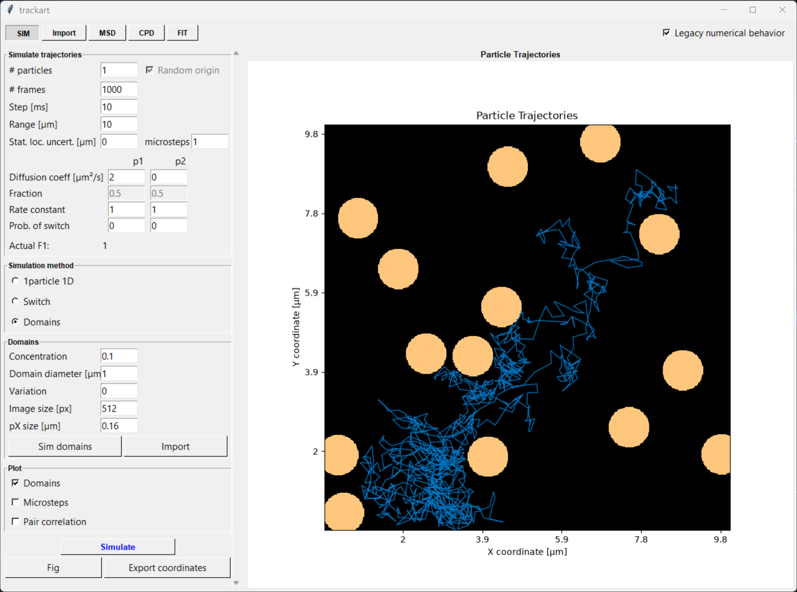

[TrackArt](https://github.com/fathi0amir/trackart-py) is a Python port of a
MATLAB tool for analyzing and simulating single-particle tracking data. It
brings the original workflow into a desktop application, with five connected
modules for trajectory simulation, data import and filtering, mean square
displacement analysis, cumulative probability distribution fitting, and final
population fitting. Built on NumPy, SciPy, Matplotlib, and Tkinter, it is
designed to make the analysis accessible while preserving the structure of the
original software.

The project supports simulations of diffusing particles, state switching, and
motion across domains, as well as importing particle-tracking data and exploring
trajectories through interactive plots and filters. Its analysis tools include
normal, anomalous, confined, and active diffusion models, along with one-, two-,
and three-population fits. Researchers can use the modules together to move from
trajectories to estimates of diffusion coefficients and population fractions.

A central goal of the port is to make results comparable with TrackArt’s MATLAB
version while also addressing several numerical issues in the original
implementation. A legacy-behavior option preserves selected original behaviors,
and automated tests check numerical recovery and regression cases. The project
is released under GPL v3.