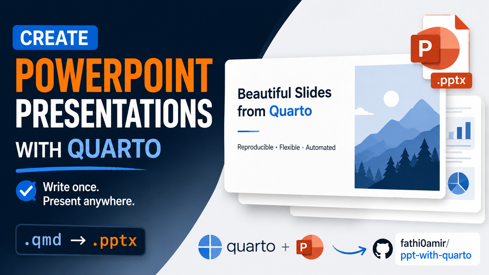

[This project](https://github.com/fathi0amir/ppt-with-quarto) brings together Quarto’s reproducible, code-driven authoring and the flexibility needed for polished PowerPoint presentations. Quarto makes it easy to build slides from plain-text source, but its default PowerPoint output can be difficult to brand, and complex LaTeX equations may not render as expected. This project addresses those gaps with a customizable PowerPoint template generated in Python, so slide styling can be controlled without manually editing the deck or relying on another office suite.

The workflow also improves the rendered slides: a Lua filter converts inline math to readable text and display equations to images, while a Python post-processing step handles issues such as text overflow, math-image sizing, code fonts, and table styling. The result is a more consistent path from a Quarto document to a presentation-ready deck, with options for customizing fonts, colors, layouts, and slide dimensions.