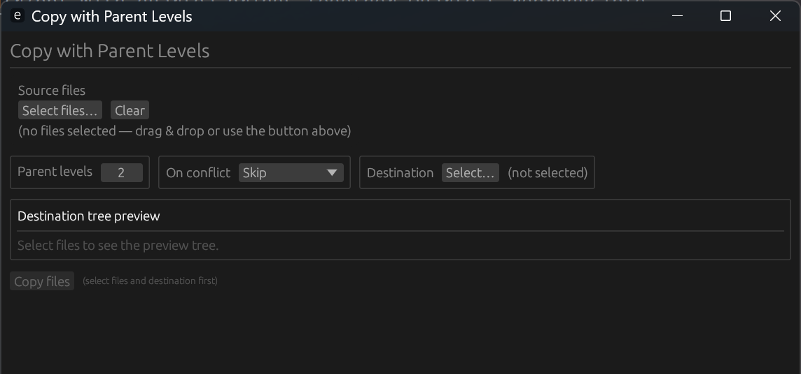

[Copy with Parent](https://github.com/fathi0amir/copy-with-parents) Levels is a small desktop utility for a familiar file-management problem: moving files into a new destination without losing the useful parts of their original folder structure. Choose how many parent-directory levels to preserve, then add files by selecting them or dragging files and folders into the app. A tree preview shows the paths that will be created before anything is copied.

The app also makes the final copy straightforward to manage. Choose a destination with a native file dialog, then decide how to handle name conflicts: skip existing files, overwrite them, or automatically rename the new copies. Built with Rust, eframe/egui, and rfd, it runs as a standalone desktop application across Windows, macOS, and Linux.