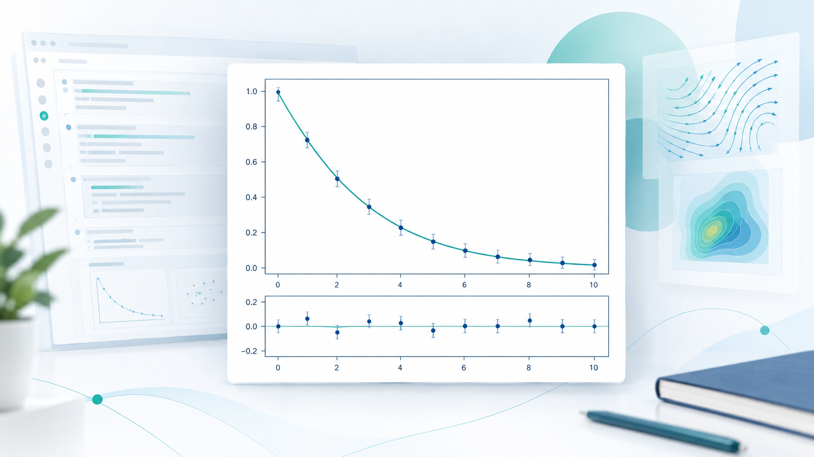

Creating publication-quality scientific figures often means balancing visual polish with an efficient workflow. [HV-Bokeh-BasicPlotting](https://github.com/fathi0amir/HV-Bokeh-BasicPlotting) explores how HoloViews and Bokeh can work together to make attractive, customizable plots directly from scientific data. Its example notebook walks through plotting a signal, fitting an exponential decay, and displaying the fit alongside its residuals.

The project includes reusable themes and axis helpers, with SVG export for further editing and publication preparation. It also uses uv for environment setup and combines nbstripout with pre-commit hooks to keep notebook outputs and transient metadata out of version control.