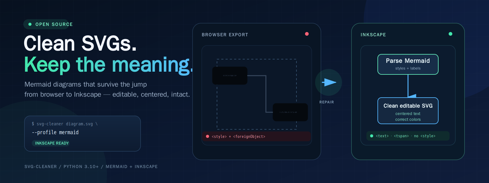

[SVG Cleaner](https://github.com/fathi0amir/svg-cleaner) was built to close the
gap between SVG exports that look correct in a browser and the files we actually
need for editing, publishing, and production. Its Mermaid profile repairs the
common failure points in mermaid-cli output by inlining usable CSS, removing
unsupported generated rules, converting HTML-based labels into editable SVG
text, and repositioning node, edge, and subgraph labels so the diagram remains
legible in Inkscape.

The result is an SVG that preserves both appearance and intent. Colors and
strokes stay attached to their shapes, labels become real text elements, and the
document no longer depends on browser-specific layout or CSS behavior. With
automatic profile detection, CLI and Python APIs, and the same cleanup pipeline
available for other SVG sources, svg-cleaner turns fragile exported diagrams
into reliable assets that are easier to inspect, modify, and reuse.