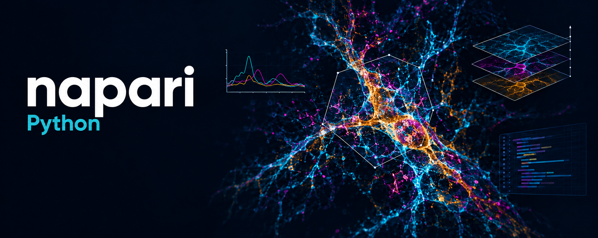

[Napari-EIA](https://github.com/fathi0amir/napari-eia) explores how an
ImageJ-style image-analysis workflow can fit naturally into Python using napari.
It’s designed for people who are comfortable exploring images interactively and
want to bring that work into a flexible, scriptable environment—without trying
to reproduce every ImageJ feature.

In the example notebook, you can open a sample image, crop around its center,
draw a region of interest (ROI), and examine measurements such as z-profiles and
line-intensity profiles. The workflow pairs napari’s interactive image viewing
with Python tools for analysis and visualization, helping connect what you see
in the image to the data behind it.

The goal is to make it easier to move from visual exploration to repeatable
analysis. By combining a notebook-based workflow with tools such as HoloViews
and Bokeh, the project also demonstrates how to create and export plots for
publication—while keeping the analysis open to customization and further
development.